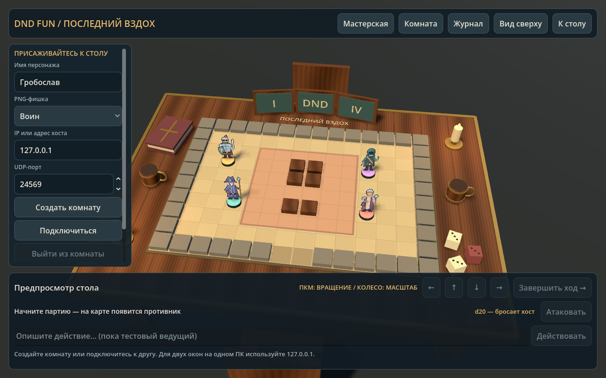
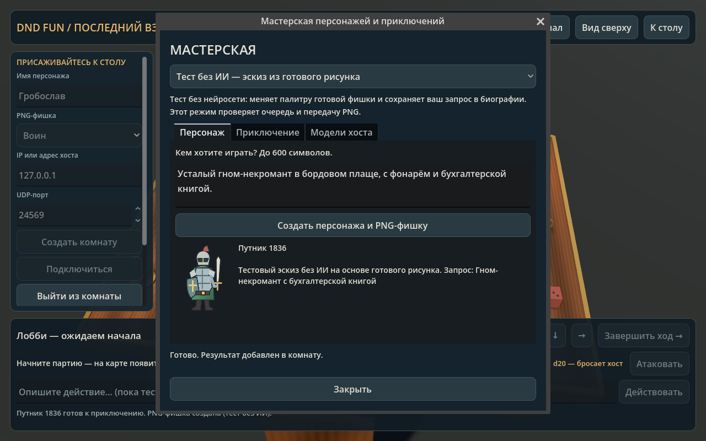
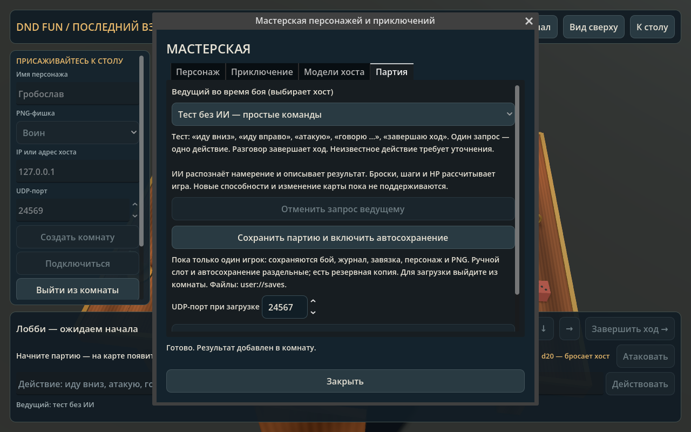

# DND Fun

Проект сетевой настольной RPG с локальным ИИ-ведущим, картой и фишками.

Статус: сетевой прототип 0.5 с 3D-столом, PNG-фишками, боем, мастерской генерации, текстовым ведущим и сохранениями для одного игрока. Сама игра работает на Godot 4.7.2 / GDScript без сторонних библиотек. Для настоящей нейросетевой генерации отдельно нужны Ollama, ComfyUI и веса моделей; сейчас они не установлены.

Целевые платформы: Linux и Windows. Основной компьютер для проверки: ноутбук с Intel i5-10300H, RTX 3050 Ti 4 ГБ VRAM и 16 ГБ RAM.

Архитектура, ограничения и порядок реализации: [docs/DESIGN.md](docs/DESIGN.md).

Реальный кадр обычного запуска (без подключённых моделей):



## Запуск

1. В менеджере проектов Godot нажмите «Импортировать» и выберите `project.godot` из этой папки.
2. Откройте проект. Режим графики уже настроен на Compatibility.
3. Нажмите **F5** (запуск проекта). Стол и четыре демонстрационные PNG-фишки видны сразу; это предпросмотр, комната ещё не создана.
4. Введите имя, выберите картинку фишки, оставьте порт `24567` и нажмите «Создать комнату». Сейчас все образы имеют одинаковые характеристики.
5. После подключения участников хост нажимает «Начать партию». Можно начать одному для знакомства со столом.

Кнопка «Начать партию» находится внизу рядом со счётчиком ходов. В лобби на столе стоят фишки подключённых игроков; демонстрационные фишки скрываются.

Если редактор показывает пустое поле: откройте сцену `scenes/main.tscn` и нажмите F5. В старом прототипе вся сцена собиралась только при запуске. Теперь узел `Table` с предпросмотром 3D-стола есть в самой сцене и работает также в редакторе; игровые панели появляются при запуске. F6 запускает текущую сцену, F5 — назначенную главную сцену проекта.

## Управление 3D-столом

- **Правая кнопка мыши + движение:** вращение камеры вокруг стола и изменение наклона.
- **Колесо:** приблизить или отдалить стол.
- **Средняя кнопка мыши + движение:** сдвиг камеры вдоль столешницы.
- **Левая кнопка:** выбрать соседнюю клетку для перемещения в свой ход.
- **«Вид сверху»:** удобный тактический ракурс.
- **«К столу»:** вернуть начальный ракурс.
- **«Комната» / «Журнал»:** показать или скрыть панели, освободив обзор.

Доступные соседние клетки отмечены зелёными точками, активная фишка — золотым кольцом, ваша — белой меткой на основании. Камера своя у каждого участника: её вращение не меняет чужой ракурс.

Стол, бумажная карта, основания фишек, свечи, кружки, книга, ширма и декоративные кубики — настоящие 3D-объекты. Герои и враг представлены прозрачными PNG, стоящими на основаниях. Карточки поворачиваются к камере, оставаясь вертикальными. Кубики на столе служат декором; игровые броски рассчитывает хост, результаты видны в панели боя и журнале.

## Первый бой: скелет-сборщик

После начала партии на карте появляется скелет. У героев 12 HP и КД 12; у скелета 10 HP и КД 11. На ход у героя есть **3 шага и 1 атака**, их можно использовать в любом порядке.

1. Подойдите к скелету на соседнюю клетку по горизонтали или вертикали. Удобный маршрут первого игрока: вниз, вправо, вниз.
2. Нажмите на картинку или основание скелета, чтобы выбрать его. Единственный враг также выбирается автоматически.
3. Нажмите **«Атаковать»**. Хост бросает d20 и прибавляет 4. Для попадания сумма должна быть не ниже КД врага. Натуральная 1 всегда означает промах, 20 — критическое попадание.
4. Урон героя — 1d6 + 2; при критическом попадании — 2d6 + 2. Промах тоже расходует атаку. После атаки можно использовать оставшиеся шаги.
5. Нажмите **«Завершить ход»**. Когда все живые герои походили, скелет делает до двух шагов по доступному пути и атакует соседнего героя: d20 + 2, урон 1d4 (2d4 при критическом попадании).

Скелет не проходит через мебель и занятые клетки. Поверженные герои пропускают ходы. Победа наступает при поражении врага, поражение — при 0 HP у всей группы. Хост может нажать **«Новый бой»**: позиции, HP и ресурсы сбросятся. Это собственная минимальная боевая система, а не полная реализация D&D.

Полная расшифровка броска и изменения HP видна в **«Журнале»**. Последний бросок также отображается рядом с кнопкой атаки. Результат броска одинаковый у всех участников; клиенты его не перебрасывают.

## Замена картинок персонажей

Откройте **«Мастерская»** в верхней панели. В лобби можно описать персонажа и создать его имя, биографию и PNG. В режиме **«Локальный ИИ»** игра обращается к Ollama и ComfyUI на компьютере хоста. Отдельный режим **«Тест без ИИ»** перекрашивает готовый рисунок и позволяет проверить работу очереди и сети без установки моделей.

Сгенерированная PNG автоматически применяется к фишке, сохраняется в кэше и передаётся остальным участникам, включая поздно подключившихся. На вкладке **«Приключение»** хост может создать завязку для текущего боя. На вкладке **«Модели хоста»** задаются имена установленных моделей.

Порядок установки, ограничения и проверенный объём реализации: [docs/LOCAL_AI.md](docs/LOCAL_AI.md). Настоящая генерация моделей пока не испытана; проверены её протоколы на локальных HTTP-фикстурах и сетевой путь PNG.



PNG находятся в `assets/tokens`. Подмените соответствующий файл и переимпортируйте его в Godot — переписывать правила и 3D-сцену не нужно. Изображения автоматически подгоняются по размеру. Подробности и имена файлов: [assets/tokens/README.md](assets/tokens/README.md).

Произвольная загрузка готового PNG через файловый диалог ещё не добавлена. Изменённые вручную встроенные файлы должны быть одинаковыми у участников или входить в общую сборку. Это ограничение не относится к портретам, созданным через мастерскую: их игра передаёт сама.

## Проверка двух игроков на одном ноутбуке

Запустите игру дважды. Например, выполните следующую команду в двух терминалах (путь к редактору соответствует текущему расположению на вашем ноутбуке):

```sh
/home/vox/Work/Self/Godot_v4.7.2-stable_linux.x86_64 --path /home/vox/Work/Self/DNDFun
```

В первом окне создайте комнату. Во втором укажите другое имя, IP `127.0.0.1` и тот же порт, затем нажмите «Подключиться». Вернитесь в окно хоста и начните партию.

Для друзей в той же сети вместо `127.0.0.1` нужен локальный IP компьютера хоста; адреса показаны под кнопками комнаты. Все участники должны использовать одну версию прототипа. Вход в уже начатую партию пока закрыт.

Через интернет нужен доступный адрес хоста и входящий **UDP**-порт `24567`, разрешённый в firewall и при необходимости проброшенный на роутере. При CGNAT потребуется другой способ связи, например виртуальная LAN. Игра сама не настраивает роутер.

## Текстовые действия и сохранения — новое в 0.5

В **Мастерская → Партия** хост выбирает ведущего:

- **Выключен**: реплики записываются в журнал и завершают ход, как в предыдущей версии.
- **Тест без ИИ**: «иду вниз», «иду вправо», «иду вверх», «иду влево», «атакую», «говорю …», «завершаю ход». Один запрос выполняет одно действие; разговор завершает ход. Непонятное действие просит уточнить намерение без расхода ресурсов.
- **Локальный ИИ — Ollama**: модель переводит свободный текст в допустимую команду. Игра проверяет её и рассчитывает последствия; второй запрос модели описывает готовый результат в стиле чёрного юмора и абсурда. Это ещё не полноценная смена сюжетных сцен или генерация новых правил.

Пока ведущий отвечает, команды заблокированы. Вкладка «Партия» позволяет отменить запрос: до расчёта действие не применяется, после расчёта сохраняется результат из журнала. Ошибка описания не вызывает повторного броска. Если исходное намерение было отклонено, ход и ресурсы сохраняются.

Для партии с одним игроком кнопка **«Сохранить партию и включить автосохранение»** записывает ручной слот и включает отдельное автосохранение до выхода из комнаты. Сохраняются HP, позиции, оставшиеся шаги и атака, круг, броски, состояние генератора случайных чисел, журнал, завязка, профиль и сама PNG. После закрытия игры откройте «Мастерская → Партия» и загрузите нужный слот; игра откроет комнату на указанном там UDP-порту. Сначала выйдите из текущей комнаты.

Файлы: `user://saves/manual.json` и `autosave.json`; предыдущая версия хранится в `.bak` и проверяется при повреждении основного файла. Сетевые партии пока нельзя сохранять: перепривязка игроков после восстановления ещё не реализована. После ручного сохранения одного игрока можно пригласить друзей, но автосохранение при двух и более игроках не выполняется.



## Что работает

- Комната до четырёх игроков, включая хоста.
- Общий 3D-стол, карта на столешнице, вертикальные PNG-фишки, выбор образа и список игроков с HP.
- Ходы по очереди, три шага за ход, переход между соседними клетками без движения по диагонали.
- Перемещение кликом по клетке или экранными стрелками. Стены, мебель и другие фишки непроходимы.
- Кнопка завершения хода и общий журнал.
- Ближний бой, d20, урон, критические попадания, здоровье, враг с поиском пути, победа, поражение и перезапуск боя.
- Мастерская: очередь запросов, тестовый эскиз без моделей, API-подключение к Ollama/ComfyUI, описание героя, подготовка прозрачной PNG и её передача по сети.
- Создание и публикация завязки текущего приключения хостом.
- Текстовые действия через тестового или локального ИИ-ведущего, проверка намерения, описание результата и отмена ожидания.
- Ручное сохранение и автосохранение партии с одним игроком, включая сгенерированную PNG.
- Проверка команд на хосте, защита от повторной команды и устаревшего состояния.
- Обработка ошибок подключения, занятого порта и отключения хоста.

При уходе участника начатая партия возвращается в лобби; хост может начать новую сцену с оставшимися игроками. При перезапуске позиции и круг сбрасываются. При уходе хоста комната закрывается.

## Что ещё предстоит

Изменение сюжетных сцен и целей по ходу игры, генерация карт и картинок врагов, способности классов, инвентарь, лечение, восстановление сетевой группы и пароль комнаты ещё не реализованы. Настоящие модели ещё нужно установить и испытать. Враг пока один, его поведение задаётся кодом. Ведущий реагирует на текстовые запросы; обычные кнопки выполняют правила без обращения к модели.

## Linux и Windows

В `export_presets.cfg` добавлены профили **Linux** и **Windows** (x86_64). В открытом редакторе установите шаблоны через **Editor → Manage Export Templates** / **Редактор → Управление шаблонами экспорта**. Нужны шаблоны той же версии, что и Godot.

В **Project → Export** выберите нужный профиль и путь для сборки, создав папку при необходимости. Друзьям передаются файлы экспортированной игры; Godot и модели им не нужны. На Windows при первом запуске комнаты может потребоваться разрешение входящих соединений в firewall.

Проверено на Linux в Godot 4.7.2. Windows-экспорт и работа между двумя разными ПК пока не проверены; локальные шаблоны экспорта ещё не установлены.

## Проверки для разработки

Python нужен только для запуска интеграционного теста, самой игре он не нужен:

```sh
python3 tests/run_tests.py --godot /home/vox/Work/Self/Godot_v4.7.2-stable_linux.x86_64
```

Тесты проверяют правила движения и боя, PNG-фишки, 3D-управление, кнопки мастерской, очередь, вырезание фона, валидацию ответов API, отмену ведущего до и после расчёта, запоздалые ответы, восстановление RNG/HP/PNG, повреждённые сохранения и реальный обмен между процессами Godot через ENet/UDP. Один сетевой сценарий сравнивает броски и урон и выполняет текстовый ход, другой передаёт PNG между раздельными каталогами кэша и проверяет позднее подключение. HTTP-модели в тестах заменены фикстурами; это не тест качества нейросетей.

Для снимка интерфейса в графическом сеансе:

```sh
/home/vox/Work/Self/Godot_v4.7.2-stable_linux.x86_64 --path /home/vox/Work/Self/DNDFun --script res://tests/capture_ui.gd
```

Снимки записываются в `/tmp/dndfun-preview-3d.png` (предпросмотр), `/tmp/dndfun-workshop.png` (тестовая генерация), `/tmp/dndfun-session.png` (ведущий и сохранения), `/tmp/dndfun-preview.png` (партия), `/tmp/dndfun-combat.png` (атака) и `/tmp/dndfun-top-3d.png` (вид сверху). Скрипт кратковременно создаёт тестовую комнату на UDP-порту `24569`.

Графика: Compatibility, простые меши, небольшие текстуры, один источник света с тенями 1024 и ограничение 60 FPS. Производительность длительной партии с ИИ на ноутбуке ещё не измерялась.
