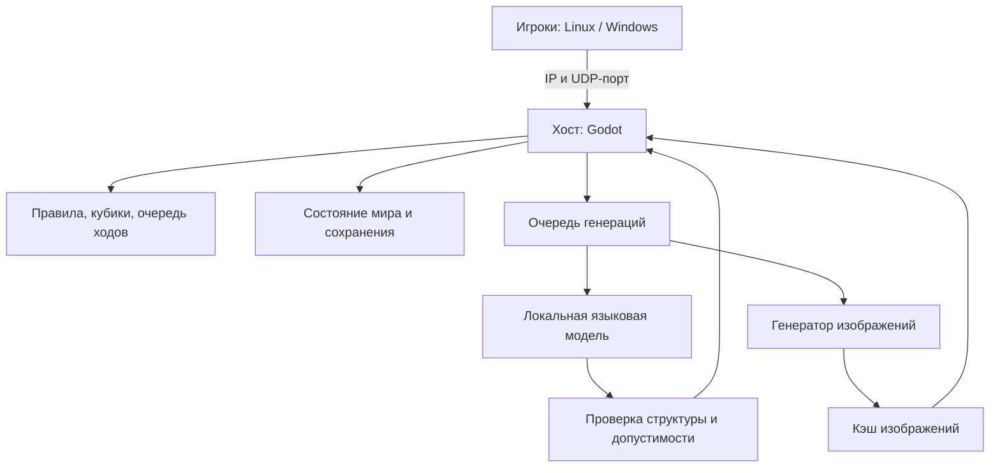

# Проект игры с ИИ-ведущим

Текущее состояние реализации: прототип 0.5 с 3D-столом, PNG-фишками, первым боем и мастерской генерации. Очередь хоста подключает API Ollama/ComfyUI для описания и новой картинки героя; PNG обрабатывается, кэшируется и передаётся клиентам. Ведущий переводит текст в проверяемую команду и описывает уже рассчитанный результат; предусмотрены тестовый режим и отмена. Хост рассчитывает d20, урон и HP. Сохранения и автосохранения восстанавливают партию с одним игроком, включая PNG и RNG. Настоящие модели ещё не установлены и не испытаны; API проверены HTTP-фикстурами. Пока нет смены сюжетных сцен, генерации карт и картинок врагов и восстановления сетевой группы. См. README и docs/LOCAL_AI.md. Разделы ниже описывают целевую архитектуру, включая ещё не реализованные возможности.

## 1. Идея и границы первой версии

Сетевая настольная RPG для 2–4 игроков. Один игрок создаёт комнату и одновременно играет; остальные вводят IP и порт. Хост хранит мир, выполняет правила и запускает ИИ. У клиентов моделей нет.

По уточнённому пожеланию игра трёхмерная: настоящий деревянный стол, карта на столешнице, миниатюры или вертикальные фишки, декоративные кубики, свечи и принадлежности ведущего. Камера вращается, приближается и сдвигается; доступен тактический вид сверху. Сгенерированные карты остаются обычными изображениями на поверхности, портреты персонажей и врагов можно размещать на вертикальных фишках. Для этого не нужно обучать генератор 3D-моделей. Игровые правила продолжают использовать логическую сетку, независимо от ракурса камеры.

Игрок задаёт тему приключения, получает персонажа и играет по очереди, вводя действия свободным текстом. ИИ трактует намерение и описывает последствия, а программный движок проверяет допустимость, бросает кубики и меняет состояние мира.

Первая версия использует собственный небольшой набор правил в духе D&D. Полное воспроизведение конкретной редакции D&D — отдельное решение: оно существенно увеличивает объём правил и контента.

## 2. Целевое оборудование

- Основной хост: i5-10300H, RTX 3050 Ti 4 ГБ, 16 ГБ RAM, Linux.
- Клиенты: Linux и Windows, без необходимости устанавливать модели.
- Графический профиль: Godot Compatibility, простая 3D-сцена, маленькие текстуры, один источник теней 1024 и ограничение 60 FPS. Тяжёлые эффекты и физическая симуляция всего стола в первую версию не входят.
- Текстовая модель: начать испытания с квантованной модели класса 1,5–4B; B означает миллиарды параметров.
- Qwen3-4B — кандидат верхней границы для сравнения, а не утверждённая модель.
- Приблизительный размер только 4-битных весов 4B — около 2 ГБ; метаданные, контекст, рабочие буферы, драйвер и сама игра требуют дополнительной памяти. Размер файла не равен полному расходу VRAM.

Не обещаем отсутствие нагрузки при генерации. Проверяем качество русского текста, время ответа, RAM/VRAM и плавность интерфейса на реальном ноутбуке. При недостатке памяти уменьшаем контекст и GPU offload, допускаем более медленный запуск на CPU.

Начальные настройки для измерений: контекст около 4096 токенов, короткий ответ, одна генерация за раз, отключённый режим длительного рассуждения у моделей, которые это поддерживают. Окончательные значения выбираются по замерам.

## 3. Технологии

| Часть | Предлагаемое решение | Причина |
|---|---|---|
| Игра, интерфейс и сервер комнаты | Godot 4, GDScript | Один проект для Linux и Windows, встроенная сеть, 3D-стол и интерфейс поверх него |
| Сеть | ENet, надёжные RPC для команд и событий | Пошаговая игра с сервером на компьютере игрока |
| Текстовый ИИ | В прототипе Ollama по локальному HTTP; сменный адаптер в дальнейшем | Квантованные модели, JSON-схема, CPU и выгрузка после ответа |
| Связь с ИИ | Асинхронный HTTP на loopback | Модель не блокирует главный поток и не открывается другим игрокам |
| Генерация изображений | ComfyUI, стандартный граф SD 1.5 | Отдельный процесс; модели и качество требуют замеров на ноутбуке |
| Сохранения | JSON со схемой и версией, журнал событий | Простая диагностика и восстановление состояния |
| Ресурсы | PNG/WebP, идентификаторы и хеши | Кэширование карт и фишек |

Версию Godot и конкретные сборки inference-runtime закрепляем при создании прототипа. Python используется позднее для подготовки датасетов и обучения; для запуска первой игры он не обязателен.

## 4. Компоненты и границы ответственности

Сетевая логика и ИИ разделены. Комната должна запускаться и играться с тестовым ведущим без скачивания моделей. Это позволяет сначала проверить саму игру.

## 5. Роли ИИ

На старте это разные задания одной загруженной языковой модели, выполняемые последовательно:

1. Сценарист: тема, завязка, цели фракций, несколько сцен, тайны и возможные развязки.
2. Автор персонажей: имя, биография, внешний вид и предложение архетипа. Характеристики и способности выбираются из разрешённого каталога и проверяются кодом.
3. Автор встреч: враги, мотивы, описание местности и предложение состава встречи. Бюджет сложности и размещение проверяет движок.
4. Интерпретатор действий: преобразует текст игрока в структурированное намерение.
5. Ведущий: получает уже рассчитанный результат, описывает его и предлагает развитие сцены.

Ведущий не переписывает произвольно HP, инвентарь, результаты кубиков или прошлые события. Предложения новых квестов и событий проходят проверку и становятся фактами только после принятия движком.

Свободный текст не означает, что программа сразу умеет любые механики. Первый набор намерений: переместиться, атаковать, взаимодействовать, использовать предмет, применить известную способность, говорить, завершить ход. Неясное действие вызывает уточнение. Сложные действия добавляются постепенно.

## 6. Порядок одного хода

1. Клиент отправляет текст, request_id и ожидаемую версию состояния.
2. Хост проверяет игрока, текущую очередь, размер сообщения и отсутствие повторного запроса.
3. ИИ возвращает намерение с типом действия, целью и параметрами по JSON-схеме.
4. Код проверяет существование цели, дистанцию, препятствия, ресурсы и доступные способности.
5. Неоднозначное намерение уточняется до броска. Недопустимое действие не расходует ход.
6. Движок выполняет бросок и рассчитывает последствия один раз; сохраняет событие.
7. Ведущий описывает результат. При таймауте или ошибке используется шаблонное описание без повторного броска.
8. Хост отправляет всем публичное событие и новую версию состояния; ход заканчивается, когда исчерпаны разрешённые действия или игрок нажал «Завершить ход».

На время обработки принятой команды повторные команды этого хода не исполняются. Невалидный JSON модели допускает ограниченную попытку исправления; после неё используется уточнение или запасной сценарий.

## 7. Мир и память ведущего

Храним структурированные данные: персонажи, характеристики, предметы, эффекты, карта, препятствия, сцена, очередь, квесты, факты и отношения NPC.

Отдельно храним публичный журнал и секреты ведущего. Клиенты не получают тайные комнаты, скрытых врагов и ещё не раскрытые сюжетные сведения.

Модель получает только относящиеся к действию факты, текущую сцену, несколько последних событий и краткое резюме. Полную историю не отправляем на каждом ходу. Резюме помогает повествованию, но источником игровых фактов остаются данные мира.

Изменение сюжета означает обновление целей, реакций и будущих сцен на основании действий игроков, а не обязательное возвращение к первоначальному сценарию. Смерть важного NPC сохраняется как факт.

## 8. Карты, персонажи и враги

Визуальное изображение и игровая сущность существуют отдельно. Красивое изображение карты само по себе не задаёт стены, двери, дистанции и проходимость.

Для первой версии код создаёт логическую карту: клетки, комнаты, стены, двери и точки появления. Поверх неё строится фон из готовых тайлов. Позднее генератор изображений получает эту разметку как ограничение; коллизии всегда берутся из логической карты.

У персонажа и врага есть карточка данных и изображение для фишки. Для героя реализован путь генерации прозрачной PNG, стоящей вертикально на круглом основании. Изображение на белом фоне обрабатывается удалением связанного с краями белого фона; качество маски нужно проверить на реальных рисунках. Встроенные образы остаются резервными. Генерация картинки врага — следующий этап.

На 4 ГБ VRAM графический генератор выбирается отдельным экспериментом. Нельзя гарантировать быструю красивую генерацию на этом оборудовании заранее. Предусмотрены готовые наборы изображений и ручной импорт.

Изображения генерируются перед партией или между сценами, сохраняются на диск и используются повторно. Языковая и графическая модели не работают одновременно; при необходимости одна выгружается перед загрузкой другой.

## 9. Сеть и сохранения

- Хост — единственный источник состояния. Клиент отправляет намерения, а не назначает себе урон, предметы или координаты.
- Комната имеет состояния: лобби, подготовка, игра, пауза, закрыта.
- Переподключившийся игрок получает разрешённый ему снимок мира и ту же персонажную сущность по токену сессии, а не по временному peer_id.
- Команды имеют request_id, чтобы повтор пакета не повторял действие.
- Снимки и события содержат монотонную версию состояния. При расхождении клиент запрашивает снимок.
- Изображения передаются ограниченными порциями с лимитом размера и проверкой хеша, отдельно от маленьких игровых сообщений.
- Сохранение выполняется атомарно после принятого действия; содержит версию схемы, состояние и журнал. Предыдущий исправный снимок сохраняется как резервный.
- При отключении текущего игрока партия приостанавливается; хост может пропустить его ход. При выходе хоста партия заканчивается с возможностью загрузить сохранение. Миграции хоста в первой версии нет.

В локальной сети используется локальный IP хоста. Для интернета при обычном NAT обычно нужен проброс UDP-порта и разрешение входящих соединений в firewall. При CGNAT одного проброса домашнего роутера может быть недостаточно: потребуется виртуальная LAN, доступный IPv6 или ретранслятор. Автоматическое подключение через любой интернет по одному IP не обещаем.

Сервис моделей слушает только loopback. Результат ИИ считается входными данными и проверяется, как команда клиента; он не может выполнять произвольный код или читать файлы по предложенному пути.

## 10. Как сделать собственные модели

Сначала проверяем готовую небольшую модель с ролями и ограниченным JSON-выводом. Это базовый результат для сравнения обучения.

Затем собираем датасет на собственных правилах и разрешённых материалах: состояние + намерение → корректный JSON; результат движка → непротиворечивое описание; тема → структура приключения.

Выделяем независимые наборы обучения и проверки, включая новые сюжеты и сложные действия. Метрики: доля корректных структур, ошибки относительно состояния, качество русского текста, время ответа и память.

Следующий шаг — LoRA/QLoRA, то есть дообучение небольшого числа дополнительных весов готовой модели. Несколько ролей могут использовать общий адаптер; отдельные адаптеры нужны только при измеримом улучшении. Обучение с нуля не входит в первоначальный план.

Ноутбук с 4 ГБ VRAM не принимаем за гарантированно достаточное оборудование для обучения. Конкретную конфигурацию проверяем отдельно; при необходимости используем другой GPU на время обучения. Получившаяся модель затем работает локально. Обучение и запуск игры — разные требования к ресурсам.

Дообучение генератора картинок — независимый поздний этап после выбора модели, визуального стиля и оценки её запуска на ноутбуке.

## 11. Этапы и условия готовности

| Этап | Результат | Как проверяем |
|---|---|---|
| 1. Сетевой стол | Создание комнаты, IP/порт, 2 клиента, карта и фишки | Хост на Linux, подключение из Windows; видны одинаковые позиции |
| 2. Игровое ядро | Персонажи, инициатива, перемещение, атака, кубики, журнал | Чужой ход отклоняется; повтор команды не повторяет бросок; сохранение восстанавливает состояние |
| 3. Локальный ведущий | Текст → намерение → правила → описание | Работает без внешнего API; ошибочный ответ модели не меняет мир; таймаут не блокирует интерфейс |
| 4. Приключения | Тема, сюжет, персонажи и встречи | Генерация проходит схему; сюжет учитывает события и секреты |
| 5. Изображения | Подготовка фонов и фишек, кэш и передача | Оба клиента видят те же ресурсы; передача не мешает ходам; память измерена |
| 6. Дообучение | Датасет, адаптер и сравнение с исходной моделью | Улучшение на независимых примерах при приемлемом времени и памяти |
| 7. Выпуск | Пакеты игры и понятная установка моделей | Чистые Linux и Windows; совместимость протокола и сохранений |

Первый вертикальный сценарий: два игрока подключаются, видят одну комнату и врага, по очереди перемещаются и атакуют; затем вводят действие текстом, которое обрабатывает локальный ведущий. Генерация изображений и обучение не являются зависимостями этого сценария.

## 12. Что измерять на ноутбуке

Сравниваем игру без ИИ, текстовую генерацию и подготовку картинки. Записываем RAM, VRAM, время до начала ответа и до полного ответа, задержки кадров, нагрев и длительную нагрузку. Отдельно испытываем работу без дискретной GPU и поведение при нехватке памяти.

Предварительная цель интерфейса — стабильные 30–60 FPS при выбранном ограничении, без зависания окна во время запроса. Это цель испытаний, а не подтверждённая характеристика. Приоритет: отзывчивость стола и корректность ходов; генерация может занимать больше времени и явно показывать прогресс.

## 13. Стиль: чёрный юмор и абсурд

Предпочтение игроков: мрачная комедия, чёрный юмор и абсурд на русском языке. Стиль задаётся настройками комнаты и инструкцией ведущему; не требует отдельной одновременно загруженной модели.

Основной кандидат для проверки: Qwen/Qwen3-4B-Instruct-2507 в GGUF Q4_K_M с коротким контекстом. Авторы отмечают улучшения творческого письма и ролевых диалогов; качество именно русского чёрного юмора нужно проверить на собственных сценах.

Дополнительный кандидат для сравнения: richardyoung/Qwen3-4B-Instruct-2507-heretic — сторонняя модификация с уменьшенной склонностью к отказам по заявлению автора. Это не подтверждает качество юмора или сохранение всех способностей. Сравниваем с исходной моделью на одинаковых сценах, включая соблюдение фактов и JSON-схемы. Одновременно модели не загружаем.

Начальный профиль комнаты: чёрный юмор 3/5, абсурд 4/5. Ненормативную лексику можно включить отдельно. Абсурд относится к устройству мира и повествованию; последствия действий и установленные факты остаются последовательными.

Пример инструкции ведущему:

> Веди настольное фэнтезийное приключение на русском языке в стиле мрачной абсурдной комедии. Используй чёрный юмор, сухую иронию, нелепую бюрократию и неожиданные последствия. Создавай повторяющиеся шутки из прошлых событий. Сохраняй характеры NPC и внутреннюю логику мира. Давай игрокам возможность действовать; не превращай каждый ответ в шутку. Описывай только переданные движком результаты бросков и изменений состояния.

Проверочные сцены: некромант с профсоюзом скелетов; дракон, требующий справку о пожарной безопасности; провал убеждения на собственных похоронах. Оцениваем русский язык, разнообразие шуток, реакцию на нестандартные действия и согласованность событий в длинном диалоге. До замеров ни качество, ни производительность не считаются подтверждёнными.

Источники кандидатов:

- https://huggingface.co/Qwen/Qwen3-4B-Instruct-2507
- https://github.com/QwenLM/Qwen3
- https://huggingface.co/richardyoung/Qwen3-4B-Instruct-2507-heretic

## 14. Официальные источники

- Godot: сеть, ENet и условия подключения через интернет: https://docs.godotengine.org/en/stable/tutorials/networking/high_level_multiplayer.html
- Godot: лицензия движка: https://godotengine.org/license/
- llama.cpp: локальное выполнение и квантование: https://github.com/ggml-org/llama.cpp
- Кандидат для испытаний Qwen3-4B: https://huggingface.co/Qwen/Qwen3-4B

Выбор моделей и производительность ещё не проверены. Документ описывает проектные решения, а не готовую реализацию.
